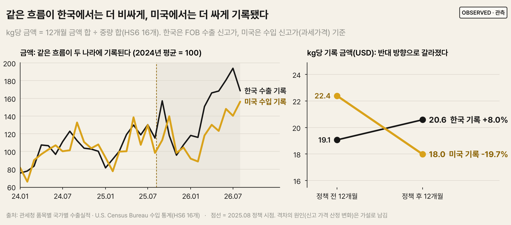
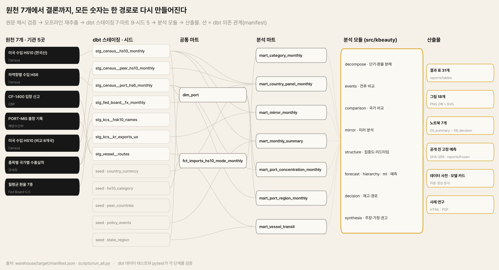

# K-뷰티 대미 수출 공급망 분석

**관세와 소액면세 중단 이후, 미국 통계가 말하지 않은 것**

2025년 8월 한국산 수입품에 15% 상호관세가 적용되고(8/7) 미국 소액면세가 모든 국가에 대해 중단됐다(8/29).
공개 데이터 7개 원천으로 그 전후 12개월의 K-뷰티 대미 수입을 측정하고, 변화의 원인 후보를 **데이터를 받기 전에 정한 기준**으로 검증하고,
미국 현지 창고에 재고를 두는 브랜드의 SCM 담당자가 내릴 결정으로 연결했다.

> **요약** [`00_summary`](notebooks/00_summary.ipynb) ·
> 분석 [`01 데이터`](notebooks/01_data_overview.ipynb) · [`02 단가`](notebooks/02_unit_value.ipynb) · [`03 국가 비교`](notebooks/03_cross_country.ipynb) ·
> [`04 미러`](notebooks/04_mirror.ipynb) · [`05 예측`](notebooks/05_forecasting.ipynb) · [`06 의사결정`](notebooks/06_decision.ipynb) ·
> [사례 연구 PDF](portfolio/case_study.pdf) · [계획](docs/PROJECT_PLAN.md) · [사전 등록](docs/preregistration.md)

## 핵심 결과

| 질문 | 답 | 근거의 강도 |
|---|---|---|
| 무엇이 늘었나 | 미국 기록 기준 수입 금액 **+11.7%**, 해상+항공 중량 **+39.5%** | 강함(전수 통계) |
| 한국만의 변화였나 | **아니다.** 사전 등록한 8개국 비교에서 기준(Holm 보정 후 p < 0.05)을 통과한 지표가 없다. 항공 단가 급락은 영국·프랑스·일본에서도 나타났다 | 강함: 금액은 모든 강건성 변형에서 0 근처 |
| 통계에 새로 잡힌 소포였나 | **아니다.** 한국 수출 기록 대비 미국 수입 기록 비율이 정책 후 **−14%**(p 0.005). 12개월 성장률은 한국 기록 +33%, 미국 기록 +12% | 강함: 시차·3개월 합계로도 같음 |
| 그럼 무엇이 달라졌나 | **같은 물량이 미국에서 더 낮은 가격으로 기록된다.** kg당 금액이 한국 측 +8%, 미국 측 −20%(12개월 합계). 전환점은 관세 인상 시기(2025년 7~8월) | 중간: 원인은 통관 단위 자료 없이 확정 불가 |
| 환율·품목 구성 때문인가 | **아니다.** 원화 약세는 미국 측 하락의 10~23%만 설명. 한국 측 상승은 비싼 품목으로의 구성 이동이고 품목 내 단가는 그대로 | 강함(항등식 분해) |
| 어떻게 예측하나 | 1개월 앞은 **직전 값**(합계 WAPE 0.112), 3개월 앞은 **품목·운송수단별 계절 ETS를 더한 예측**(0.160). '작년 같은 달'은 모든 수준에서 하위권. 머신러닝 9종을 검증 성적으로 고른 모델은 1개월 앞 0.109로 직전 값보다 낮았지만 차이가 통계적으로 구분되지 않아(DM p 0.91), 개선을 입증하지 못한 것으로 보고 직전 값 기준선을 유지했다. 공식 기준은 Linux 고정 환경이고, 작성 환경 값 0.138은 진단 이력이다(모델 카드 8절). 80% 예측 구간은 실제 포함률 71~78%로 좁다 | 3개월 앞은 DM p 0.001(n = 6) |
| 담당자는 무엇을 결정하나 | 해상 수입 금액의 **82%가 LA·롱비치**, 정책 후 해상 리드타임 변화 없음. 내륙 운송이 **약 14일 이하**면 서부 하역이 재고를 덜 묶고(들쑥날쑥하면 10~13일), LA·롱비치 2주 중단은 해상 수입 **5,500만 달러** 지연 | 관측 + 시나리오(내륙·수요 변동은 가정) |

**가장 중요한 한 줄**: 미국 통계만 보면 "K-뷰티가 더 싸게 더 많이 들어온다"이지만, 같은 흐름의 한국 통계는 "더 비싼 품목을 더 많이 보냈다"고 기록한다.
정책 이후 벌어진 이 격차는 환율과 품목 구성으로 설명되지 않으며, 미국 측 신고 가격의 변화를 시사한다(가설). 이 분석은 인과 효과를 주장하지 않는다.



### 처음 서술에서 바뀐 것

미국 통계만으로 시작한 분석이 검증을 거치며 세 가지 서술을 고쳤다(이유는 [사전 등록 변경 기록](docs/preregistration.md)).

| 처음 서술 | 검증 | 고친 서술 |
|---|---|---|
| 9월 항공 단가 급락은 정책 시점과 가장 잘 맞는 한국의 신호 | 8개국 비교 | 여러 나라의 공통 변화이며, 한국은 그중 가장 크게 떨어진 쪽 |
| 소포가 통계에 새로 잡혔는지 구분할 수 없다 | 한국 수출 통계와의 미러 분석 | 미국/한국 기록 비율이 오히려 떨어져 소포 가설은 지지되지 않음 |
| 상품이 kg당 더 싸졌다 | 한국 측 기록, 환율 분해 | 한국 측 kg당 금액은 올랐다 → 미국 측 신고 가격의 변화에 가깝다 |

## 데이터

원천은 7개, 기관은 5곳이다.

| # | 원천 (링크) | 기관 | 내용 | 단위 |
|---|---|---|---|---|
| 1 | [국제무역 API `imports/hs`](https://api.census.gov/data/timeseries/intltrade/imports/hs.html) (한국산, CTY_CODE 5800) | 미국 Census | HS 3303·3304·3305·3307 수입액, 해상·항공 금액·중량 | HS10 × 월 |
| 2 | [국제무역 API `imports/porths`](https://api.census.gov/data/timeseries/intltrade/imports/porths.html) (한국산) | 미국 Census | 하역항별 수입액, 해상·컨테이너·항공 금액·중량 | 하역항 × HS6 × 월 |
| 3 | [CF-1400 외국 무역선 입항 기록](https://www.cbp.gov/document/report/cf-1400-record-vessel-foreign-trade-entrances) | 미국 CBP | 미국 입항 항구, 신고일, 직전 외국항 | 선박 1회 입항 |
| 4 | [해양수산부 선박운항정보(PORT-MIS)](https://www.data.go.kr/data/15006353/openapi.do) | 해양수산부 | 부산항 출항 일시, 다음 기항지, 호출부호 | 선박 1회 출항 |
| 5 | [국제무역 API `imports/hs`](https://api.census.gov/data/timeseries/intltrade/imports/hs.html) (비교 8개국) | 미국 Census | 프랑스·캐나다·이탈리아·중국·멕시코·영국·독일·일본의 같은 품목 | 국가 × HS10 × 월 |
| 6 | [관세청_품목별 국가별 수출입실적(GW)](https://www.data.go.kr/data/15100475/openapi.do) | 관세청 | 한국 → 미국 수출 금액(FOB)·중량, 품목명 | HSK10 × 월 |
| 7 | [Federal Reserve Board G.5 월평균 환율](https://www.federalreserve.gov/releases/h10/current/default.htm) 7개 통화(원·유로·엔·위안·캐나다달러·페소·파운드), 릴리스 XML | Federal Reserve Board | 1달러당 자국 통화(유로·파운드는 역수) | 통화 × 월 |

- 3과 4는 공통 식별자가 없어 호출부호·선박명으로 선박 단위로 연결한 관측치(1,005건, 통계 사용 661건) 한 파일로 쓴다([출처 설명](data/raw/vessel_routes/PROVENANCE.md)).
- 수집 코드(`pipeline/`)는 API 응답 원문을 `data/raw/`에 그대로 보관한다(Census JSON, 관세청 XML.gz, Federal Reserve Board XML zip). 실제 요청 주소(키 제외)와 수집 시각은 원천별 manifest에 있다. 이 저장소는 원문에서 시작하므로 API 키 없이 전 과정이 재현된다.
- Census API 안내: [International Trade 데이터셋 문서](https://www.census.gov/data/developers/data-sets/international-trade.html).
- 환율은 최초 분석에서 FRED를 통해 접근한 Board G.5 계열을 썼고, 2026-11-06부터 Federal Reserve Board 릴리스 XML 직접 수집으로 교체했다(전 기간 값 동일, `docs/experiments/fred_to_federal_reserve_board.md`).
- This product uses the Census Bureau Data API but is not endorsed or certified by the Census Bureau.

## 구조

```
data/raw (원천 7개의 응답 원문) ─▶ pipeline/ (오프라인 재추출) ─▶ data/extracted/*.csv ─▶ warehouse/ (dbt + DuckDB) ─▶ src/kbeauty ─▶ notebooks · reports
 해시 88개 파일                  원본과 바이트 단위 일치 검증          스테이징 7 · 마트 9 · 데이터 테스트 49        노트북 7 · 표 31 · 그림 18
```



| 경로 | 내용 |
|---|---|
| `pipeline/` | 수집기(Census 한국산·하역항·비교국, 관세청, Federal Reserve Board 환율, 관세청 품목명). `--offline`이면 보관된 원문만 읽는다(외부 요청 0회) |
| `warehouse/` | dbt 프로젝트: 시드(품목 분류, 주→권역, 정책 일정, 비교국, 국가 통화), 스테이징, 마트, 데이터 테스트 |
| `src/kbeauty/` | 분석 패키지: 단가·환율 분해(`decompose`), 전후 비교(`events`), 국가 비교(`comparison`), 미러 분석(`mirror`), 집중도·리드타임(`structure`), 예측(`forecast`, `hierarchy`, `ml`, `freeze`), 의사결정(`decision`), 주장·가정·권고 종합(`synthesis`), 표(`report`), 시각화 계층(`viz`) |
| `notebooks/` | `00_summary`(결론 먼저) · `01_data_overview` · `02_unit_value` · `03_cross_country` · `04_mirror` · `05_forecasting` · `06_decision`. 각 노트북은 질문과 답을 먼저 보이고, 의문이 풀리는 순서로 근거를 쌓은 뒤 결론에 근거 수준(관측·추정·추론·시나리오)을 붙인다. 진단·강건성 상세와 `run_all` 결과와의 일치 assert는 부록에 둔다 |
| `tests/` | pytest 78개: 분해 항등식, 위약 검정, 이중차분·평행 추세·합성 통제, 미러 분석, 계층 정합·예측 구간, 예측의 미래 정보 차단, 머신러닝 선택 규칙·재현성, 안전재고, 원본 해시, 오프라인 재추출, 웨어하우스 빌드 |
| `reports/` | 표 31개(`tables`, 최종 산출물 `decision_recommendations`·`claims`·`assumptions` 포함), [모델 카드](reports/model_card.md), [데이터 사전](reports/data_dictionary.csv)(171개 열), 그림 18개(`figures`, PNG 2배 해상도 + 편집 가능한 SVG), 데이터 공개 전에 고정한 예측(`frozen`: 주 예측 30개, 머신러닝 240개) |
| `docs/` | 프로젝트 계획, 사전 등록(변경 기록 포함) |
| `warehouse/column_glossary.yml` | 데이터 사전의 열 설명. 웨어하우스에 설명 없는 열이 생기면 테스트가 실패한다 |
| `appendix/` | 합성 운영 데이터(132만 행) 검증 — 방법론 부록 |
| `portfolio/` | 사례 연구 페이지와 PDF |

## 실행

```bash
uv sync                                   # Python 3.12, 의존성 설치
uv run python scripts/run_all.py          # 해시 검증 → 오프라인 재추출 → dbt build("49/49 data tests passed") → 표·그림
uv run python scripts/compare_tables.py --exact   # 다시 만든 표 31개가 커밋본과 바이트 단위로 같은지(같은 환경)
uv run pytest                             # 테스트 78개
uv run jupyter nbconvert --to notebook --execute --inplace notebooks/00_summary.ipynb
```

새 월을 받으려면 `.env`에 `CENSUS_API_KEY`, `DATA_GO_KR_KEY`를 넣고 수집기를 실행한 뒤, `src/kbeauty/paths.py`의 수집 범위(`CENSUS_DATA_END`, `KCS_DATA_END`)만 바꾸고 `uv run python scripts/run_all.py --write-sums`로 해시를 갱신한다. 같은 파일의 분석 날짜(정책 전후 창, 정책 월, 백테스트 첫 기준 시점)는 사전 등록 값이라 바꾸지 않는다.
Census가 2026-09~11월을 공개하면 `uv run python scripts/score_frozen_forecasts.py`로 고정 예측을 채점한다(고정 파일은 수정하지 않는다).

## 검증

| 장치 | 막는 문제 |
|---|---|
| 원문 SHA-256 대조, 오프라인 재추출 바이트 일치, `.gitattributes`로 줄바꿈 변환 금지 | 원본·추출 코드가 몰래 바뀐 채 분석되는 것 |
| dbt 데이터 테스트 49개: 하역항 합계 = 전국 합계(1달러), 월 연속성, 9개국 패널 균형, 환율 커버리지, 미러 합계 보존, 리드타임 범위 | 추출 누락, 잘못된 조인, 결측 월, 잘못된 선박 연결 |
| 사전 등록과 변경 기록 | 결과를 본 뒤 기준·비교군을 바꿔 유의성을 만드는 것 |
| 시간 × 국가 위약 순위(최대 117개), Holm·BH 보정, 검출 한계(MDE), 평행 추세 검정, 강건성 7종 | 우연한 시점 일치, 다중비교, 전제가 깨진 이중차분 |
| pytest: 미래 값을 10배로 바꿔도 예측 불변, 정합 후 합계 일치, 분해 항등식 | 백테스트 누수, 공식 오류 |
| 분석 노트북 마지막 셀의 assert | 노트북과 `run_all` 결과가 서로 다른 숫자를 말하는 것 |
| 결과 표 재현: 공식 기준은 Linux 고정 환경이다(스레드 1, OpenBLAS Haswell 커널, numpy AVX-512 비활성화). CI는 31개 표 전체를 `reports/platform/linux/`와 바이트 단위로 비교한다. 같은 job 안에서는 예측·ML 단계를 두 번 더 실행해 결정성을 검사한다. 작성 환경(Windows)과는 플랫폼 불변 표 23개를 허용 오차(rtol 1e-6)로, 민감 표 8개를 규칙으로 비교한다 | 코드 변경으로 결과가 조용히 바뀌는 것, runner CPU에 따라 결과가 달라지는 것. CPU의 AVX-512 지원 여부에 따라 BLAS 커널이 달라지는 것이 원인으로 확인됐다(`docs/experiments/linux_determinism.md`) |
| CI(`.github/workflows/ci.yml`): 깨끗한 Linux에서 `run_all` → pytest → 표 검사, 만든 표를 실행 산출물로 보관. 비밀값·네트워크 수집 없음 | 내 PC에서만 재현되는 결과 |
| 데이터 공개 전 예측 고정(SHA-256) | 결과를 보고 예측을 고치는 것 |
| 차트 폰트 번들(Pretendard 정적 OTF 4종, SHA-256 기록)과 경로 직접 등록, 저장 전 글리프 검사 | OS마다 다른 폰트로 그려지거나 글자가 조용히 다른 폰트로 대체되는 것 |
| 차트마다 근거 수준 배지(OBSERVED · ESTIMATED · INFERRED · SCENARIO) | 시나리오 계산이 관측값처럼 읽히는 것 |

## 한계

- 원인은 확정하지 않았다. 미국 측 신고 가격 하락의 원인은 통관 단위 자료 없이는 검증할 수 없는 가설이다.
- 정책 이후 12개월, 비교국 6~8개라 검출 한계가 크다. 환율·미국 수요·유통 채널 같은 동시 요인을 완전히 배제하지 못했다.
- 한국 수출 통계에는 운송수단 구분이 없고, 두 나라의 세번 분류가 일부 다르다(마스크 팩 등).
- 리드타임은 '부산 출항 → 미국 입항 신고'까지이며, 통관·내륙 운송·운임은 시나리오로만 다뤘다.
- 예측 백테스트의 기준 시점은 8개(3개월 앞 6개)뿐이다.
- 예측 대상은 **공개 수입통계**(미국 Census가 기록한 금액)다. 기업 내부 판매·재고·발주 데이터를 쓰는 수요예측이 아니며, 발주 판단을 돕는 외부 시장 흐름 지표로만 쓴다. 의사결정 결과도 최적화가 아니라 조건부 판단 기준이다.

## 출처

- 상호관세 15%(2025-08-07): [WilmerHale, 2025-08-04](https://www.wilmerhale.com/en/sitecore/content/whlaunch/home/research/news-publications/20250804-president-trump-announces-new-reciprocal-tariffs--set-to-take-effect-this-week)
- 소액면세 중단(EO 14324, 2025-08-29): [White & Case](https://www.whitecase.com/insight-alert/united-states-suspend-customs-de-minimis-entry-most-shipments-august-29-2025)
- 소액면세 화물의 Census 통계 제외: Fajgelbaum & Khandelwal, *The Value of De Minimis Imports*, [NBER WP 32607](https://www.nber.org/papers/w32607) (2024)
- 데이터 원천 7개의 링크는 위 [데이터](#데이터) 절.
